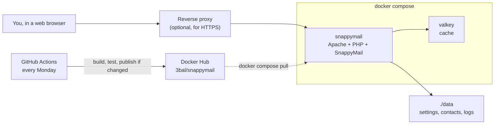

# SnappyMail Container

This project builds a Docker image of [SnappyMail](https://snappymail.eu/), a
webmail client. The image contains the official PHP Apache image, every PHP
extension that SnappyMail can use, and the SnappyMail release itself. A weekly
GitHub Actions job builds the image again, tests it, and publishes it to
Docker Hub as [`3bal/snappymail`](https://hub.docker.com/r/3bal/snappymail)
when SnappyMail, PHP or Debian received an update.

- Web mail: `http://<host>:8080/`
- Admin panel: `http://<host>:8080/?admin`

## Goals

The project has these goals:

1. Run the newest SnappyMail release with every PHP extension that SnappyMail can use.
2. Receive SnappyMail releases and the security updates of PHP and Debian every week, without manual work.
3. Give every process the least privileges it needs.
4. Stay simple: one image, one optional cache, one command to start.

## How it works



`snappymail` serves the web mail. It keeps its data in `./data`, the only
folder it can write to. `valkey` holds the cache, if you enable the cache
plugin.

## Why these choices

| Question | Choice | Other options | Reason |
| --- | --- | --- | --- |
| Which base image? | Official `php:8.6-apache` | `php:*-fpm` with nginx, `djmaze/snappymail` | Apache serves the static files and runs PHP in one process, so one container is enough. SnappyMail's own `.htaccess` files protect its code folder. The image of the SnappyMail author gets a new build only for a new SnappyMail release. |
| Where is SnappyMail? | Inside the image | Downloaded at start | One image is one tested version. An update is `docker compose pull`. No download at start. |
| How is the download checked? | Signature by the SnappyMail release key | Checksum | The build fails unless the release has a valid signature by the key that SnappyMail's own code trusts (`1016 E470 7914 5542 F8BA 1335 4820 8BA1 3290 F3EB`). |
| Which user? | `www-data` with uid 82, on port 8080 | root, uid 33 | No process runs as root. Uid 82 is `www-data` in Alpine images, so data folders from `djmaze/snappymail` work without a `chown`. |
| How to get updates? | Weekly build with `--pull --no-cache` | A fixed image | The job takes the newest SnappyMail release and the newest PHP and Debian packages. |
| When to publish? | Only when the image changed, and only after the tests pass | Every week | A fingerprint of the Debian packages, PHP, its extensions and SnappyMail decides. `ci/smoke-test.sh` must pass first. |
| Which cache? | Valkey with the SnappyMail "Cache Redis" plugin | Files only | The plugin includes its own PHP client (Predis), so PHP needs no `redis` extension. |
| Which contacts database? | SQLite | MySQL, PostgreSQL | It needs no extra service. |

### PHP extensions

The image adds `intl gd zip apcu gnupg tidy ldap imagick` to the official
image. The admin panel of SnappyMail lists some other extensions as missing.
They are not needed:

| Extension | Reason |
| --- | --- |
| `redis` | The "Cache Redis" plugin includes its own client. |
| `uuid`, `xxtea` | SnappyMail has its own PHP code for these. The extensions are only faster. |
| `pdo_mysql`, `pdo_pgsql` | Only for a MySQL or PostgreSQL contacts database. SQLite is used. |
| `gmagick` | An alternative to `imagick`. The two cannot be loaded together. |

## Installation

### Requirements

- Docker Engine with the Compose v2 plugin
- Internet access, to pull the images

### Steps

1. Clone the repository, then go into it:

   ```bash
   git clone https://github.com/ebal/SnappyMail_Container.git snappymail
   cd snappymail
   ```

2. Create the data folder. It must belong to uid 82, because SnappyMail does not run as root:

   ```bash
   mkdir -p data && sudo chown 82:82 data
   ```

3. Optional: create `.env` for the settings of this host. Each line is optional; without it, the default applies:

   ```bash
   HTTP_PORT=8080                          # host port of the web mail
   TZ=UTC                                  # time zone of PHP
   SNAPPYMAIL_IMAGE=3bal/snappymail:latest # the image (default)
   VALKEY_IMAGE_TAG=9-alpine               # valkey image tag (default), for example 9.2-alpine3.24
   ```

4. Start the stack:

   ```bash
   docker compose up -d --wait
   ```

5. Make sure that the services are healthy:

   ```bash
   docker compose ps
   ```

   ```text
   SERVICE      IMAGE                    STATUS
   snappymail   3bal/snappymail:latest   Up (healthy)
   valkey       valkey/valkey:9-alpine   Up (healthy)
   ```

6. Open `http://<host>:8080/?admin` once. SnappyMail then writes the admin password to a file. Show it:

   ```bash
   sudo cat data/_data_/_default_/admin_password.txt
   ```

7. Log in to the admin panel as `admin`. Change the password and add your mail domains.

8. Optional: use Valkey as the cache:

   ```bash
   scripts/enable-valkey-cache.sh
   ```

   ```text
   == install the Cache Redis plugin
   installed
   == point it to valkey:6379
   == enable plugins, and add cache-redis to the enabled plugins
   enabled_list = "cache-redis"
   == check: load the login page, then count keys in valkey
   2
   ```

   The script installs the "Cache Redis" plugin with the installer of SnappyMail, which checks the signature of the package. Plugins that are already enabled stay enabled. The plugin can print `PHP Deprecated` notices about Predis. They are harmless.

## Usage

### Update

Pull the new images and apply them:

```bash
docker compose pull && docker compose up -d --wait
```

`latest` follows new SnappyMail releases and PHP and Debian updates.
[What's Up Docker](https://getwud.github.io/wud/) can tell you when a new
image is available. To stay on one SnappyMail version, set
`SNAPPYMAIL_IMAGE=3bal/snappymail:3.1.3-php8.6` in `.env`.

### Tags

| Tag | Moves? | Content |
| --- | --- | --- |
| `latest` | yes | The newest SnappyMail release, on the newest PHP 8.6 image |
| `<snappymail>-php8.6`, for example `3.1.3-php8.6` | yes, for PHP and Debian updates | One SnappyMail release |
| `<snappymail>-php8.6-YYYYMMDD` | no | One build, for a rollback |

### Build the image yourself

```bash
docker compose build --pull
docker compose up -d --wait
```

Set the SnappyMail version with `--build-arg SNAPPYMAIL_VERSION=3.1.3`. Then
test the image:

```bash
ci/smoke-test.sh 3bal/snappymail:latest 3.1.3
```

### Publish the image to Docker Hub

`.github/workflows/publish.yml` runs every Monday at 04:00 UTC, on each push
that changes the image, and on demand. It builds the image, runs
`ci/smoke-test.sh`, and pushes only when the tests pass. A scheduled run
publishes only a changed image. Set these in the GitHub repository, under
Settings > Secrets and variables > Actions:

| Kind | Name | Value |
| --- | --- | --- |
| Variable | `DOCKERHUB_USERNAME` | Your Docker Hub user or organization |
| Variable | `DOCKERHUB_REPOSITORY` | The image name. Optional, default `snappymail`. |
| Secret | `DOCKERHUB_TOKEN` | A Docker Hub access token with Read & Write access, nothing more |

The workflow has read access to the repository only. Its actions are pinned
to commit hashes. GitHub disables a scheduled workflow after 60 days without
commits and sends an e-mail first: run the workflow once by hand to enable it
again.

### Behind a reverse proxy

Apache takes the real client address from `X-Forwarded-For` when the request
comes from a private range or from Tailscale (`100.64.0.0/10`). Caddy and
Traefik send this header by default. Point the proxy to port 8080 of the
`snappymail` service.

### Move from the djmaze/snappymail image

This project uses the same data path, `/var/lib/snappymail`, and the same
owner, uid 82. Copy the data of the old container into `./data`.

## Layout

| Path | Content |
| --- | --- |
| `Dockerfile` | Download and check SnappyMail, then build the image on `php:8.6-apache`. |
| `docker-compose.yml` | The services `snappymail` and `valkey`, hardened: read-only, no Linux capabilities, `no-new-privileges`. |
| `config/apache.conf` | Apache site: port 8080, `.htaccess` files, real client address. |
| `config/php.ini` | Upload size, memory, time zone. |
| `keys/snappymail-releases.asc` | The SnappyMail release key, as shipped in SnappyMail releases. |
| `scripts/enable-valkey-cache.sh` | Installs and enables the "Cache Redis" plugin for Valkey. |
| `ci/smoke-test.sh` | Starts an image and checks pages, protected folders, user and extensions. |
| `ci/fingerprint.sh` | Hash of the packages and versions in an image. |
| `.github/workflows/publish.yml` | Weekly build, test and publish to Docker Hub. |
| `VERSION` | Version of this repository (SemVer). The image tags follow SnappyMail and PHP instead. |
| `data/`, `.env` | The data and the host settings. Not in git. Back up `data/`. |

## Troubleshooting

| Problem | Cause | Fix |
| --- | --- | --- |
| `Permission denied` in the log, the container is unhealthy | `./data` does not belong to uid 82 | `sudo chown -R 82:82 data` |
| The admin password file is missing | The admin panel was not opened yet | Open `/?admin` once. |
| The build fails with "no valid signature" | The download is not signed by the SnappyMail release key | Do not use that download. Check the release on GitHub. |
| The publish job fails at the login | The Docker Hub variable or secret is missing | Set `DOCKERHUB_USERNAME` and `DOCKERHUB_TOKEN` (see above). |

## License

[BSD-3-Clause](LICENSE) for the files of this repository. SnappyMail is
AGPL-3.0. PHP, Apache and Valkey have their own licenses. The image contains
SnappyMail, PHP and Apache; their licenses apply to the image.
