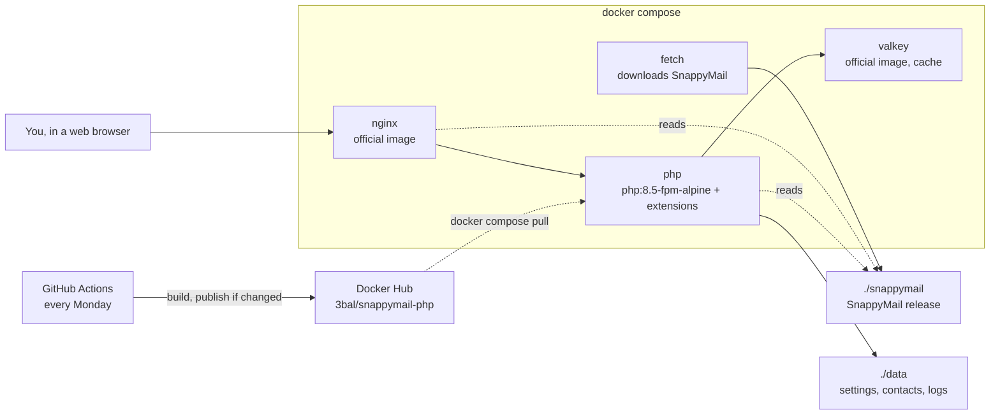

# SnappyMail Container

This project runs [SnappyMail](https://snappymail.eu/), a webmail client, with
Docker Compose. It uses official images for nginx and Valkey, and a small PHP
image built from the official `php:8.5-fpm-alpine` image with every PHP
extension that SnappyMail can use. SnappyMail itself is downloaded from its
GitHub release and kept on disk, outside the images. A weekly GitHub Actions
job builds the PHP image again and publishes it to Docker Hub as
[`3bal/snappymail-php`](https://hub.docker.com/r/3bal/snappymail-php) when PHP
or Alpine received an update.

- Web mail: `http://<host>:8080/`
- Admin panel: `http://<host>:8080/?admin`

## Goals

The project has these goals:

1. Run the newest SnappyMail release with every PHP extension that SnappyMail can use.
2. Receive the security updates of PHP and Alpine every week, without manual work.
3. Stay simple. One 3-line Dockerfile, official images for everything else, and one command to start.

## How it works



`fetch` runs first. It downloads the SnappyMail release into `./snappymail`
and makes sure that the checksum is correct. `php` runs the PHP code of
SnappyMail and keeps the data in `./data`. `nginx` sends the static files and
passes each PHP request to `php`. `valkey` holds the cache, if you enable the
cache plugin.

## Why these choices

| Question | Choice | Other options | Reason |
| --- | --- | --- | --- |
| Which image? | Own PHP image on `php:8.5-fpm-alpine`, official `nginx` | `djmaze/snappymail`, other PHP images | The image of the SnappyMail author gets a new build only for a new SnappyMail release: no build between October 2024 and October 2026. The other public PHP images lack extensions (see below). |
| How to get updates? | Weekly build with `--pull --no-cache` | A fixed image version | The official PHP image gets a new build for each PHP or Alpine fix. A weekly build takes these fixes. |
| When to publish? | Only when the image changed | Every week | The job compares a fingerprint of the Alpine packages and the PHP and extension versions with the published image. |
| Where is SnappyMail? | `./snappymail` on disk, read-only in the containers | Inside the image | A SnappyMail update does not need a new image, and the web server cannot change the code. |
| Which cache? | Valkey with the SnappyMail "Cache Redis" plugin | Files only | The plugin includes its own PHP client (Predis), so PHP needs no `redis` extension. |
| Which contacts database? | SQLite | MySQL, PostgreSQL | It needs no extra service. |

### PHP extensions

The image adds `intl gd zip apcu gnupg tidy ldap imagick` to the official
image. The admin panel of SnappyMail lists some other extensions as missing.
They are not needed:

| Extension | Reason |
| --- | --- |
| `redis` | The "Cache Redis" plugin includes its own client. |
| `uuid`, `xxtea` | SnappyMail has its own PHP code for these. The extensions are only faster. |
| `pdo_mysql`, `pdo_pgsql` | Only for a MySQL or PostgreSQL contacts database. SQLite is used. |
| `gmagick` | An alternative to `imagick`. The two cannot be loaded together. |

### Public PHP images compared on 2026-11-18

All with PHP 8.5.12. "Missing" lists the extensions from the list above.

| Image | Missing | Size |
| --- | --- | --- |
| `php:8.5.12-apache` | intl, gd, zip, apcu, gnupg, imagick, tidy, ldap | 524 MB |
| `wordpress:php8.5-apache` | apcu, gnupg, tidy, ldap | 809 MB |
| `chialab/php:8.5-apache` | apcu, gnupg, tidy | 755 MB |
| `webdevops/php-apache:8.5` | gnupg, tidy | 1222 MB |
| `serversideup/php:8.5-fpm-apache` | intl, gd, apcu, gnupg, imagick, tidy, ldap | 542 MB |
| `thecodingmachine/php:8.5-v5-slim-apache` | intl, gd, pdo_sqlite, apcu, gnupg, imagick, tidy, ldap | 286 MB |
| this project | none | 317 MB |

## Installation

### Requirements

- Docker Engine with the Compose v2 plugin
- Internet access, for the image and the SnappyMail download

### Steps

1. Clone the repository, then go into it:

   ```bash
   git clone https://github.com/ebal/SnappyMail_Container.git snappymail
   cd snappymail
   ```

2. Create `.env` for the settings of this host. Each line is optional; without it, the default applies:

   ```bash
   HTTP_PORT=8080                                 # host port of the web mail
   TZ=UTC                                         # time zone of PHP
   SNAPPYMAIL_PHP_IMAGE=3bal/snappymail-php:8.5   # the published image (default: build locally)
   VALKEY_IMAGE_TAG=9-alpine                      # valkey image tag, for example a fixed 9.1.4-alpine
   ```

3. Start the stack. With `SNAPPYMAIL_PHP_IMAGE=3bal/snappymail-php:8.5`, Docker pulls the published PHP image. Without it, the first start builds the PHP image (about 4 minutes):

   ```bash
   docker compose up -d --wait
   ```

4. Make sure that the services are healthy:

   ```bash
   docker compose ps -a
   ```

   ```text
   SERVICE   IMAGE                    STATUS
   fetch     alpine:3.24              Exited (0)
   nginx     nginx:stable-alpine      Up (healthy)
   php       3bal/snappymail-php:8.5  Up (healthy)
   valkey    valkey/valkey:9-alpine   Up (healthy)
   ```

5. Open `http://<host>:8080/?admin` once. SnappyMail then writes the admin password to a file. Show it:

   ```bash
   sudo cat data/_data_/_default_/admin_password.txt
   ```

6. Log in to the admin panel as `admin`. Change the password and add your mail domains.

7. Optional: use Valkey as the cache:

   ```bash
   scripts/enable-valkey-cache.sh
   ```

   ```text
   == install the Cache Redis plugin
   installed
   == point it to valkey:6379
   == enable plugins and this plugin
   == check: load the login page, then count keys in valkey
   3
   ```

   The script installs the "Cache Redis" plugin with the installer of SnappyMail, which checks the signature of the package. The plugin can print `PHP Deprecated` notices about Predis under PHP 8.5. They are harmless.

## Usage

### Update SnappyMail

1. Find the new version and the SHA-256 of `snappymail-<version>.tar.gz` on the [releases page](https://github.com/the-djmaze/snappymail/releases).
2. Set `SNAPPYMAIL_VERSION` and `SNAPPYMAIL_SHA256` in `docker-compose.yml`.
3. Apply the change:

   ```bash
   docker compose up -d --wait
   ```

`fetch` downloads the new release and replaces `./snappymail`. The data in
`./data` stays.

### Update PHP, nginx and Valkey

With the published image (`SNAPPYMAIL_PHP_IMAGE=3bal/snappymail-php:8.5`), pull the new images:

```bash
docker compose pull && docker compose up -d --wait
```

[What's Up Docker](https://getwud.github.io/wud/) can tell you when a new
image is available.

With a local build, run `ci/rebuild.sh`. It builds the PHP image again and uses
it only if it changed:

```bash
ci/rebuild.sh            # use the new PHP image only if it changed
FORCE=1 ci/rebuild.sh    # use the new PHP image in any case
```

```text
== build snappymail-php:candidate
php 8.5.12, fingerprint new=f1c82cdbe463aa7f in use=f1c82cdbe463aa7f (snappymail-php:8.5)
== php image unchanged
== pull official images
== apply
```

### Publish the image to Docker Hub

`.github/workflows/publish.yml` runs every Monday at 04:00 UTC, on each push
that changes `php/`, and on demand. A scheduled run publishes only a changed
image. Set these in the GitHub repository, under Settings > Secrets and
variables > Actions:

| Kind | Name | Value |
| --- | --- | --- |
| Variable | `DOCKERHUB_USERNAME` | Your Docker Hub user or organization |
| Variable | `DOCKERHUB_REPOSITORY` | The image name. Optional, default `snappymail-php`. |
| Secret | `DOCKERHUB_TOKEN` | A Docker Hub access token with Read & Write access |

The image of this repository is
[`3bal/snappymail-php`](https://hub.docker.com/r/3bal/snappymail-php). To publish
from a fork, set your own values. The job pushes three tags: `8.5` and `latest`,
which move to each new build, and `8.5-YYYYMMDD`, which stays. GitHub disables a scheduled workflow after 60
days without activity in the repository. The last step of the job enables the
workflow again on each scheduled run.

### Behind a reverse proxy

nginx takes the real client address from `X-Forwarded-For` when the request
comes from a private range or from Tailscale (`100.64.0.0/10`). Caddy and
Traefik send this header by default. A client on the same private network can
also set this header.

### Move from the djmaze/snappymail image

This project uses the same data path, `/var/lib/snappymail`. Copy the data of
the old container into `./data`. `fetch` sets the owner to uid 82 at each
start.

## Layout

| Path | Content |
| --- | --- |
| `docker-compose.yml` | The services `fetch`, `php`, `nginx` and `valkey`, and the SnappyMail version. |
| `php/Dockerfile` | `php:8.5-fpm-alpine` plus the extensions. |
| `config/nginx.conf` | nginx site. It blocks the code and data folders, as the `.htaccess` files of SnappyMail do for Apache. |
| `config/php.ini` | Upload size, memory, time zone. |
| `scripts/fetch-snappymail.sh` | Downloads and checks the SnappyMail release, writes `include.php`. |
| `scripts/enable-valkey-cache.sh` | Installs and enables the "Cache Redis" plugin for Valkey. |
| `ci/fingerprint.sh` | Hash of the packages and versions in a PHP image. |
| `ci/rebuild.sh` | Local rebuild: build, compare, apply. |
| `.github/workflows/publish.yml` | Weekly build and publish to Docker Hub. |
| `snappymail/`, `data/`, `.env` | The release, the data and the host settings. Not in git. Back up `data/`. |

## Troubleshooting

| Problem | Cause | Fix |
| --- | --- | --- |
| `fetch` exits with a checksum error | `SNAPPYMAIL_SHA256` does not match the download | Copy the SHA-256 from the release page again. |
| The admin password file is missing | The admin panel was not opened yet | Open `/?admin` once. |
| `Permission denied` in `data/` | The data belongs to uid 82 (`www-data` in Alpine) | Use `sudo`. `fetch` sets the owner at each start. |
| The publish job fails at the login | The Docker Hub variable or secret is missing | Set `DOCKERHUB_USERNAME` and `DOCKERHUB_TOKEN` (see above). |

## License

[BSD-3-Clause](LICENSE) for the files of this repository. SnappyMail is
AGPL-3.0. PHP, nginx and Valkey have their own licenses. They are downloaded
and are not part of this repository.
